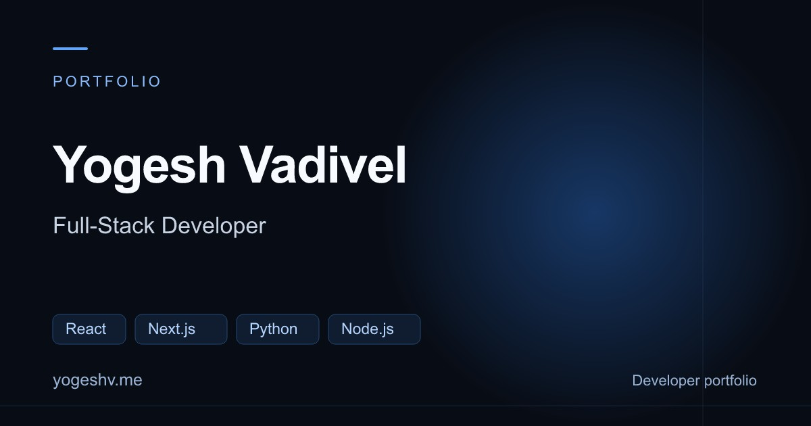

# Yogesh Vadivel — Portfolio

Source for **[yogeshv.me](https://yogeshv.me/)**. React 18, TypeScript, Vite, Tailwind CSS, and Framer Motion; hosted on GitHub Pages.



## Run locally

Requires Node.js 22.12+, 24 LTS, or 26+ and npm. Validation uses Node.js 24.

```sh
npm ci
npm run dev
```

Development: `http://localhost:8080`. Production preview: `npm run preview`, then `http://localhost:4173`. Contact configuration is in `.env.example`.

## Production checks

```sh
npm run lint
npm run test
npm run build
```

The build type-checks, bundles, prerenders every public route, generates `sitemap.xml`, and verifies HTML, schema, canonical URLs, local links, responsive images, and social image size. There are six indexable routes:

- `/`
- `/projects/`
- `/resume/`
- `/projects/stockpredict-ai/`
- `/projects/expensevision/`
- `/projects/verdict-games/`

Unknown public URLs return a branded static HTTP 404 with `noindex`. Client-side missing routes also have `noindex`. The legacy query-string SPA receiver remains for old shared links; the 404 page no longer redirects unknown URLs to a homepage response.

## SEO and content

`src/lib/seo.ts` is the source of truth for titles, descriptions, canonical URLs, Open Graph/Twitter metadata, and JSON-LD. The build emits full HTML on all six routes. The homepage has one copy of the animated name in its H1; metric counters contain their final values in the initial HTML. The main hero introduction is visible before hydration so entrance animations do not delay its first paint.

The profile connects `Person`, `ProfilePage`, and `WebSite` entities to the owner's GitHub and LinkedIn profiles. The degree is explicitly **B.Tech. in Computer Science and Engineering, Manipal Academy of Higher Education, Dubai**. The projects index uses `CollectionPage` and `ItemList`; project pages use `TechArticle`, `SoftwareSourceCode`, `SoftwareApplication`, and breadcrumbs. There are no invented reviews, ratings, prices, qualifications, or user counts.

Each public page has a distinct 1200×630 JPEG social card, currently under 70KB. Project pages have descriptive search titles, architecture flows, implementation notes, honest limitations, related-project links, resume links, and a contact CTA. Project facts were checked against their public source repositories on 10 November 2026. Historical backtest figures include their period and context. Project review dates are explicit content dates, not generated from the build clock. The sitemap omits optional `lastmod` values rather than inventing update dates.

Automatic location variants are preserved. Transient location text uses `data-nosnippet`; the shared search description focuses on identity, work, and credentials. Location adaptation is not a substitute for separately indexable regional pages, and Google decides which snippets and AI summaries to show.

The complete audit and owner checklist are in [docs/seo-qa.md](docs/seo-qa.md).

## Appearance, accessibility, and performance

Theme follows the operating system until the visitor chooses an override, saved in `portfolio-theme`. All six skill groups and the animated name remain. Mobile layouts use readable type and consistent spacing. Resume and project pages include home/project navigation, PDF or source actions, and theme controls.

The resume opens directly in a PDF viewer, without an HTML summary or an extra preview button. Open and Download use the same automatically selected document. Viewer code loads only on the resume route; its large dependency still produces a Vite chunk warning. PDF download or viewer failures leave the page header and direct PDF actions available.

Shared route handling opens new pages at the top, scrolls section links to their headings, and restores the saved position on browser Back/Forward. Footer navigation connects the homepage, projects, resume, and contact section. Project pages also include breadcrumbs, related projects, live demos, and source links.

GitHub activity loads as About enters view. Before that, prerendered HTML includes a useful GitHub profile link. Every device uses the same full-year data; the graph scrolls horizontally and the yearly total remains visible. No contribution count is hardcoded.

Home project previews contain four manually navigated screenshots; the project pages retain full galleries. Arrow keys work in carousels, lightboxes trap focus and close on Escape, and image frames reserve space. There is no carousel autoplay to pause. Screenshots use responsive WebP variants. Fonts are self-hosted variable WOFF2 files with `font-display: swap`; the main Inter font is preloaded and both SIL OFL licenses are retained in `public/fonts/`.

Cloudflare Web Analytics is already installed for production hosts. Local previews do not send analytics. The contact form includes validation, a honeypot, duplicate-request protection, a 30-second retry cooldown, and success/error feedback. Client controls are not a replacement for EmailJS allowed-origin restrictions and provider-side abuse controls.

## Regional profile and resume

One shared country lookup controls the hero badge, About location, and resume:

| IP country | Profile location | PDF |
| --- | --- | --- |
| India (`IN`) | Madurai, Tamil Nadu, India | India |
| Any other country | Dubai, UAE | UAE |
| Lookup unavailable/invalid/timed out | Dubai, UAE | UAE |

Selection has no version selector and ignores legacy `region` query parameters. While lookup is pending, profile wording is neutral and PDF actions wait. Education and past employment locations remain factual.

The static site uses GeoJS's country endpoint with a four-second timeout. Only country and timestamp are cached in session storage for 30 minutes. The app does not store IP addresses or request device location; GeoJS receives the visitor's IP as part of its request. VPNs and service availability can affect detection. Browser language/timezone do not determine selection. A footer disclosure explains this and the site's other browser storage and services.

The supplied PDFs remain unchanged, selectable, linked, and approximately 63KB each. Both already have the title `Yogesh Vadivel - Full-Stack Developer` and the correct degree/experience. To replace them, keep these names:

```text
public/resumes/Yogesh_Vadivel_Resume_India.pdf
public/resumes/Yogesh_Vadivel_Resume_UAE.pdf
```

## Asset maintenance

Original screenshots live in `assets/source-screenshots/`; only responsive WebP outputs in `public/` are deployed. To regenerate them with optional Python/Pillow tooling:

```sh
python scripts/optimize-images.py
```

Social card SVG sources live in `assets/social-cards/`. To regenerate SVGs and JPEG exports with optional Python tooling:

```sh
python -m pip install Pillow resvg-py
python scripts/generate-social-cards.py
python scripts/render-social-cards.py
```

Normal builds need only Node.js; generated images and fonts are committed. The screenshot optimizer only updates project screenshots; social cards are generated separately with the scripts above.

## Source layout

```text
public/                  Deployment assets, regional PDFs, fonts, social cards
src/components/          UI sections, shared headers, PDF and GitHub widgets
src/data/                Experience, education, locations, projects, skills, resumes
src/hooks/               Shared country detection and UI hooks
src/lib/                 Metadata, image helpers, country cache, motion presets
src/pages/               Home, project index, resume, project pages, missing pages
src/test/                Regional, viewer, static HTML, SEO, contact, theme tests
scripts/                 Prerendering, verification, optional asset generation
assets/                  Original screenshots and SVG social sources
docs/                    Audit evidence, security review, account follow-up
```

## Publish

```sh
npm run deploy
```

This builds and publishes `dist/` to `main` in `Yogesh-VG0/Yogesh-VG0.github.io`; source is in `Yogesh-VG0/Yogesh-Portfolio_Source`. Keep `CNAME` for the custom domain and `.nojekyll` for Pages. Confirm the Pages workflow succeeds and all canonical routes return HTTP 200 after publishing.

Search Console, Bing Webmaster Tools, profile pins/links, EmailJS dashboard settings, external app backlinks/attribution, and social-preview account settings require their respective accounts. The source code cannot force rankings, immediate indexing, or a rewritten Google AI Overview.
